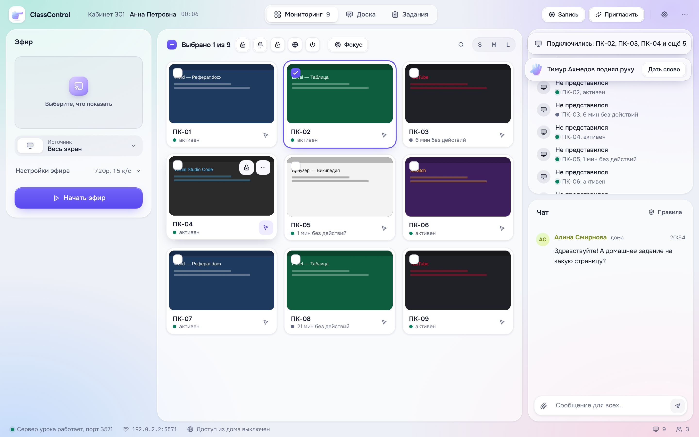

# ClassControl

Управление компьютерным классом и уроки для тех, кто дома. Работает **без аренды серверов**:
нужны только компьютер учителя, компьютеры учеников в классе и браузер у тех, кто дома.

> **Попробовать прямо сейчас** — с виртуальным классом, на любом компьютере. Нужен только [Node.js 20+](https://nodejs.org):
> - Windows — двойной щелчок по `start.cmd`;
> - macOS — `start.command`;
> - Linux — `./start.sh`.
>
> Подробнее — в разделе [«Попробовать за 2 минуты»](#попробовать-за-2-минуты--на-любом-компьютере).

| Часть | Где работает | Что делает |
|---|---|---|
| **ClassControl** (`teacher/`) | компьютер учителя | Мониторинг экранов, управление ПК, эфир, доска, чат, запись, отчёт урока. Внутри — сервер урока. |
| **ClassControl Agent** (`agent/`) | компьютеры класса | Сам находит учителя в сети, присылает экран, выполняет команды, показывает эфир и доску. |
| **Страница урока** (`online/`) | браузер ученика дома или с телефона | Эфир и доска, чат, «поднять руку», голос по разрешению учителя, показ своего экрана на 5 минут. |
| Сервер урока (`server/`) | внутри приложения учителя | Связь всех со всеми, чат, доска, файлы, задания. |
| Общий интерфейс (`shared/ui/`) | везде | Дизайн-система «Мягкое стекло», маскот «Указка», светлая и тёмная темы. Шрифты и иконки лежат локально, интернет для интерфейса не нужен. |

## Как это работает без серверов

- **В классе.** Агенты находят компьютер учителя по UDP в локальной сети: учитель сам объявляет себя каждые 3 секунды, а агент запоминает «своего» учителя, даже если в сети несколько кабинетов. Видео идёт напрямую между компьютерами (WebRTC), интернет не нужен.
- **Из дома.** Учитель нажимает «Пригласить» → «Доступ из дома». Приложение запускает бесплатный туннель Cloudflare (без аккаунта и оплаты) и показывает ссылку с QR-кодом. Видео по-прежнему идёт напрямую между компьютерами. Если сеть ученика этого не пропускает, через 12 секунд автоматически включается запасной режим: кадры идут через компьютер учителя.
- **Данные урока** (чат, доска, опросы, работы) живут только во время урока. Материалы урока сохраняются только по решению учителя и туда, куда он укажет.

## Кабинет постоянный, урок одноразовый

Программа — инструмент для урока в кабинете с компьютерами. Постоянны только кабинет и его компьютеры. Учителя, группы учеников и ученики за ПК меняются.

- **Кабинет настраивается один раз.** Нужно название кабинета и кнопка «Закрепить ПК за этим кабинетом». Закреплённые ПК подключаются только к учителю своего кабинета. Если незакреплённый ПК попал к соседу, тот нажимает «Это не мой компьютер».
- **Урок одноразовый.** При запуске программы учитель вводит своё имя только на этот урок. У урока новая ссылка и код, чат, доска и задания пустые.
- **«Завершить урок».** Учитель сохраняет материалы урока (чат, доска, опросы, сданные работы, файлы) в любую папку или на флешку либо не сохраняет их. После этого всё стирается с компьютера, ученики из дома видят «Урок закончился», а старая ссылка перестаёт работать. Сразу открывается «Новый урок» для следующего учителя.
- **Если программу закрыли посреди урока,** при следующем запуске она предложит продолжить его, сохранить материалы или начать с чистого листа. Сама она ничего не продолжает.
- **Запись урока** сохраняется туда, куда укажет учитель, а не в общую папку.
- **Посещаемости и списков классов нет.** Это не журнал, а инструмент на время урока.
- **Мониторинг и управление ПК** работают всегда, вне зависимости от урока.

### Человек отдельно, место отдельно
- Ответы, работы, личные сообщения и поднятая рука принадлежат ученику, а не компьютеру. На каждом уроке агент спрашивает «Кто за компьютером?».
- **Пересадка.** Ученик пересел, представился на новом ПК и ответил на вопрос «Вы пересели?». Прежний ПК освобождается, а всё нужное переходит с ним. Учитель может пересадить и сам. Ученик пришёл из дома в класс — это тот же человек.
- **Тёзки.** Если такое имя уже есть на уроке, человек отвечает «это я» или добавляет фамилию.

## Как выглядит



Мягкие полупрозрачные панели над цветными пятнами, пружинные анимации, светлая и тёмная темы (по умолчанию как в системе).

Маскот «Указка» — мягкая градиентная рука **без лица и глаз**: это вещь, а не персонаж. У неё три жеста:
- **указывает**: на поле имени, вверх — «внимание на учителя»;
- **ладонь**: поднятая рука, «урок начался», «до встречи»;
- **большой палец**: «работа сдана», «весь класс ответил».

Все правила — в [`docs/design-system.md`](docs/design-system.md).

## Возможности

**Учитель**
- Сетка экранов класса (S/M/L, поиск, выбор нескольких ПК с Ctrl/Shift), статус «активен / N мин без действий / заблокирован».
- Удалённое управление мышью и клавиатурой (nut-js); ученик видит плашку «Учитель подключился».
- Команды для выбранных или всех ПК: заблокировать экран, сообщение на экран, открыть сайт, список программ с кнопкой «Закрыть», выключить, перезагрузить, завершить сеанс.
- Эфир: выбор экрана или окна, качество и частота кадров, смена источника на лету, звук компьютера, микрофон (слышат только ученики дома, чтобы в кабинете не было эха), «ученики могут закрыть эфир».
- Доска — бесконечный холст, как в FigJam: ручка, ластик, рука, цвета, толщина, отмена (Ctrl+Z), масштаб к курсору, «показать всё», сохранение в PNG. Ученики видят ровно то, что видит учитель, и не могут уехать в другое место холста.
- Ученики дома: поднятые руки, «дать слово» (голос ученика слышат все), просмотр экрана ученика и кнопка «Показать всем», личные сообщения, отключение от урока.
- **Задания**: быстрый опрос с живой диаграммой ответов и показом итогов классу; сбор работ (файлы ложатся в папку с именами учеников, видно, кто ещё не сдал); раздача файла на рабочий стол каждого ПК класса.
- **Фокус**: учитель выбирает «отвлекающие» сайты и программы (YouTube, игры…), карточка ПК подсвечивается, если ученик их открыл.
- Выключенные ПК не пропадают из сетки: видно, кто и когда отключился.
- **Каскадный эфир** для большого класса: учитель передаёт видео только нескольким ПК, а они — соседям. Если «передающий» ПК выключили, остальные переподключаются сами.
- Светлая и тёмная тема, по умолчанию — как в системе.
- Запись урока в файл, который пишется на диск частями. Источник выбирается сам: открытый экран ученика → доска → эфир → окно приложения. В запись попадают голос учителя и голоса учеников.

**Агент ученика**
- Задание учителя сам кладёт на рабочий стол в папку «Задания». Опрос и сдача работы — в небольшом окне поверх остальных.
- Сторож в планировщике Windows: если агент закрыли через Диспетчер задач, через минуту он снова на связи. Администратор может выключить его в настройках до перезагрузки.
- В трее один пункт — «Открыть беседу». Настройки только через «Пуск → ClassControl → Настройки агента» под паролем администратора (название ПК, адрес учителя, автозапуск, выключение агента).

## Попробовать за 2 минуты — на любом компьютере

Для пробы не нужен ни класс, ни вторая машина. Запускается **виртуальный класс**:
- 12 компьютеров с живыми экранами, за ними представляются ученики, они отвечают на опросы и сдают работы, один «смотрит YouTube»;
- трое учеников из дома пишут в чат и поднимают руку;
- страница ученика сама откроется в браузере.

Нужен только [Node.js 20+](https://nodejs.org) (LTS). Скачайте проект (зелёная кнопка **Code → Download ZIP**) или клонируйте его, затем:

| Система | Как запустить |
|---|---|
| **Windows** | Двойной щелчок по `start.cmd`. Если Node.js нет, файл сам предложит поставить его через winget. |
| **macOS** | Двойной щелчок по `start.command` (при первом запуске — правый щелчок → «Открыть»). |
| **Linux** | `./start.sh` |
| Любая, из терминала | `npm start` |

При первом запуске зависимости ставятся сами (пару минут), дальше запуск мгновенный. Данные пробы хранятся отдельно и не смешиваются с настоящим кабинетом.

**Ещё легче — только браузер**, без установки приложения:

```bash
npm run demo:web
```

Окно учителя и страница ученика откроются в браузере. Нет только записи урока в файл и доступа из дома — их умеет приложение.

**Настоящий агент ученика рядом с учителем:**

```bash
npm start -- --agent
```

Блокировка и эфир при этом открываются обычными окнами, чтобы не закрыть экран учителя.

**Настоящий урок без виртуального класса:**

```bash
npm start -- --real
```

## Установщики для Windows, macOS и Linux

Собираются на серверах GitHub: **Actions → «Сборка установщиков» → Run workflow**.

| Где | Что получится |
|---|---|
| Раздел **Artifacts** | `.exe` (Windows), `.dmg` (macOS, Intel и Apple Silicon), `.AppImage` (Linux) — для приложения учителя и агента |
| Тег `v*` (например, `v2.1.0`) | Те же файлы появятся в **Releases** |

Установщики без платной подписи. Windows покажет «Неизвестный издатель» → «Подробнее» → «Выполнить в любом случае». В macOS при первом запуске — правый щелчок → «Открыть».

Собрать у себя:

```bash
npm --prefix teacher run build:win
```

Вместо `win` — `mac` или `linux`; то же для `agent`. Файлы появятся в `dist/`.

Модуль туннеля `cloudflared` можно заранее положить в `bin/`. Если его нет, приложение учителя скачает его само для своей системы.

## Разработка

```bash
npm run setup
```

```bash
npm run teacher
```

```bash
npm run agent
```

```bash
npm test
```

## Защита урока от спама

- **Всегда:**
  - одинаковые сообщения и поток сообщений не проходят;
  - «стена текста» обрезается;
  - поднятая-опущенная рука присылает учителю одно уведомление в 20 секунд;
  - показать экран можно не чаще трёх раз за 5 минут.
- **Кнопка «Правила» у чата:**
  - пишут все;
  - медленный режим — одно сообщение в 20 секунд;
  - только учителю — одноклассники не видят;
  - файлы от учеников можно выключить.
- **Тому, кто мешает,** можно выключить чат до конца урока. Переподключение не помогает: запрет у человека, а не у вкладки.
- Ученик сразу видит правило у поля ввода, кнопка «Отправить» сама считает секунды.

## Слабые компьютеры

Кнопка-шестерёнка → **Производительность**. Пресет **«Слабые компьютеры»** одним нажатием включает:
- облегчённую графику у учителя и на ПК учеников;
- эфир 720p при 10 кадрах;
- обновление экранов раз в 2 секунды.

Графика «Авто» сама облегчается на компьютерах с 4 ядрами или 4 ГБ памяти и меньше. Интерфейс тот же, но без размытия стекла и бесконечных анимаций.

Отдельно настраиваются частота и чёткость экранов в мониторинге и качество записи. Все настройки сохраняются сами. У ученика дома есть «Экономный режим» в меню.

## Безопасность

- Учитель входит только с этого же компьютера и по случайному ключу, который выдаётся при каждом запуске.
- Ученик попадает на урок только по коду урока.
- Загрузить файл или сдать работу можно только с секретным ключом своего подключения: подделать учителя или сдать работу за другого нельзя.
- Если приложение учителя закрылось или упало, через минуту блокировка экранов и удалённое управление у учеников снимаются сами.
- Агентом может стать только компьютер из локальной сети, а не подключение через туннель.
- Имя в чате назначает сервер, подделать «Учителя» нельзя. Сигналы WebRTC ученик может отправлять только учителю.
- Файлы проверяются по списку разрешённых типов (SVG и исполняемые файлы запрещены) и скачиваются как вложение. Хранятся 24 часа.
- В окнах Electron включены `contextIsolation` и `sandbox`, у страниц есть CSP.

## Документы

Текст дипломной работы, ТЗ, презентация и сценарии демонстрации лежат в [`docs/`](docs/). ТЗ на доработки после проверки на настоящих компьютерах — в [`docs/feedback-2026-11-05.md`](docs/feedback-2026-11-05.md).
