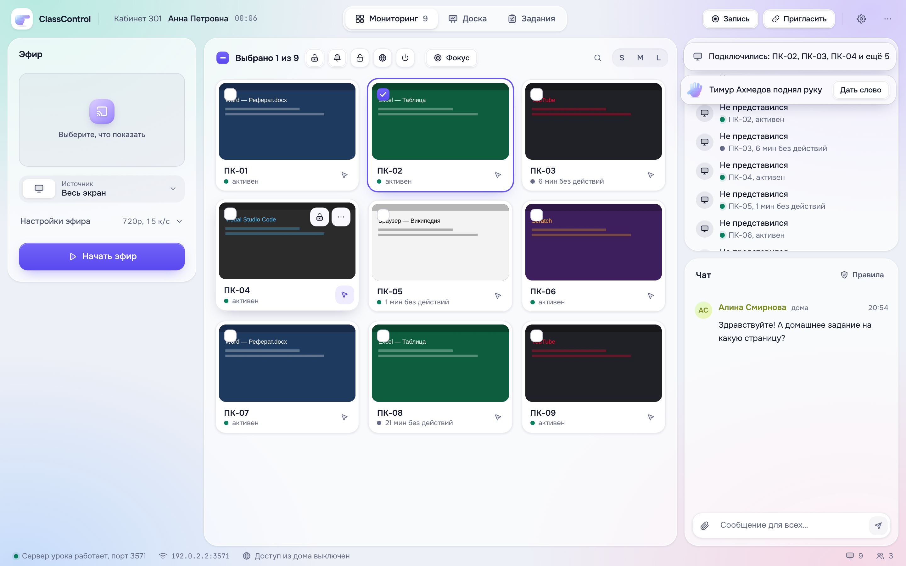
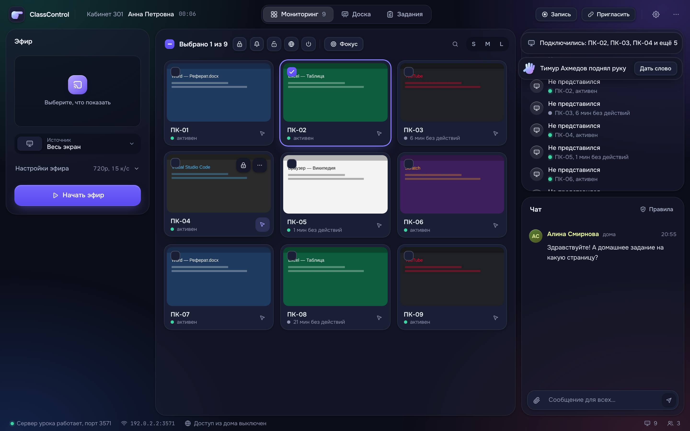
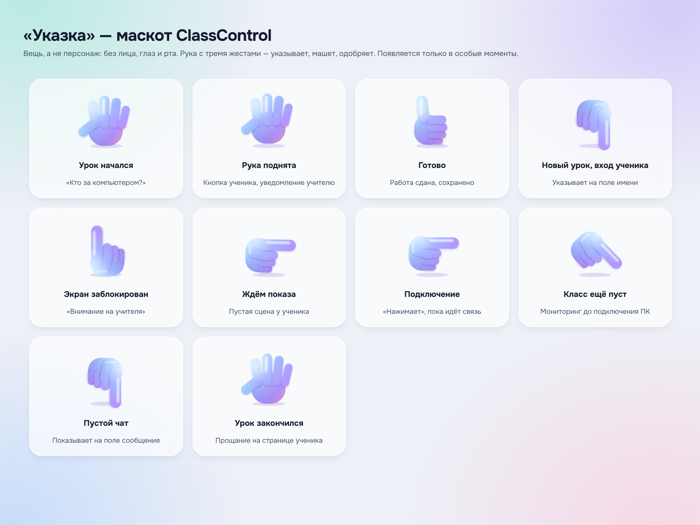

# Дизайн-система «Мягкое стекло»

Один файл стилей на все три части — `shared/ui/theme.css`. Учитель, агент и страница ученика выглядят и двигаются одинаково.

## Атмосфера

Воздух, мягкий свет и полупрозрачные поверхности над тёплыми пятнами цвета: мята, небо, сирень, персик. Резких линий нет — поверхности отделяет свет и тень, а не рамки. Цвет появляется только там, где он что-то значит.




## Слои

| Слой | Токен | Где |
|---|---|---|
| Фон | `--ground` + `--aura` | Окно целиком. Четыре цветных пятна рисуются один раз и ничего не стоят. |
| Панель | `--surface` + светлая кромка `--edge` | Колонки: «Эфир», мониторинг, участники, чат |
| Карточка | `--raised` + `--shadow-1` | Карточки ПК, задания, кнопки |
| Стекло | `--glass-strong` + `backdrop-filter` | Диалоги, меню, уведомления — всё, что парит |

Размытие (`backdrop-filter`) есть только у всплывающих элементов. Под ними редко что-то меняется, поэтому сетка из 30 живых экранов не тормозит.

## Цвет

| Смысл | Токен | Для чего |
|---|---|---|
| Акцент | `--accent`, `--grad-primary` | Выбор, главное действие (одно на экран) |
| Эфир, запись | `--live` | Только то, что идёт прямо сейчас |
| Готово | `--positive` | Связь есть, работа сдана |
| Внимание | `--warning` | «Фокус», нет связи |
| Бренд | `--grad-brand` | Только маскот и особые моменты |

Цвета людей (аватары, имена в чате) берутся из имени. Светлоту задаёт тема (`--tint-*`), поэтому имя читается и в светлой, и в тёмной теме.

Весь текст контрастнее 4.5:1 на своей поверхности (WCAG AA).

## Темы

Светлая «Утро» и тёмная «Вечер». По умолчанию тема как в системе. Учитель может выбрать её в меню, ученик — кнопкой в шапке.

Тему ставит `theme-init.js` до первой отрисовки, поэтому вспышки нет. Смена темы идёт плавным переходом (View Transitions).

## Размеры

- **Отступы** кратны 4px. Между колонками 12px, внутри панели 16–18px.
- **Радиусы** вложены друг в друга: панель 22 → карточка 16 → кнопка 11 → метка 8. Внутренний радиус меньше внешнего на величину отступа.
- **Шрифт** — Onest (переменный, кириллица) и JetBrains Mono для кодов, таймеров и адресов. Шрифты лежат локально.

## Движение

- **Пружины.** Кривые `--spring` и `--spring-bouncy` — это затухающие колебания, записанные через CSS `linear()`. Движение мягкое, как в iOS, без библиотек.
- **Только `transform` и `opacity`.** Анимации идут на видеокарте.
- **Нажатие:** кнопка сжимается до 96% и пружинит обратно.
- **Появление:** диалоги, уведомления и карточки въезжают снизу с лёгким увеличением. Уходят быстрее, чем появляются.
- **Смена режима** «Мониторинг / Доска / Задания» — плавный переход через View Transitions API.
- **Меньше движения.** Если в системе включено «уменьшить движение», анимации выключаются.

## Иконки

Набор «Мягкий контур» (`shared/ui/icons.js`):
- сетка 24×24, линия 1.7 px со скруглёнными концами;
- у главных знаков — дуотон, мягкая заливка того же цвета 16%;
- иконка читается и мелкой, и крупной, но не спорит с текстом;
- на цветных плитках (`.tile--mint/sky/lilac/peach`) знак белый, плитка — с внутренним бликом.

## Переключатели

У всех сегментированных переключателей (вкладки, инструменты, размеры карточек, настройки) выбранный пункт подсвечивает одна «капсула». Она переезжает к новому пункту с пружиной (`CC.glide`) — двигается только `transform`.

## Производительность

На `<html>` ставится `data-perf`:

| Значение | Что меняется |
|---|---|
| `lite` | Нет `backdrop-filter`, бесконечных анимаций и тяжёлых теней. Стекло становится плотной поверхностью. |
| `min` | Дополнительно никаких анимаций и переходов. |

Графика «Авто» выбирает `lite` на компьютерах с ≤ 4 ядрами или ≤ 4 ГБ памяти. Учитель может включить облегчённую графику для всего класса — она приходит на ПК учеников с сервера урока.

## Маскот «Указка»



Мягкая градиентная рука. Жесты (`gesture`):

| Жест | Что значит |
|---|---|
| `point` | Указывает, как типографский знак ☞ |
| `palm` | Ладонь: поднятая рука, привет, до встречи |
| `thumb` | Большой палец: готово, сдано, весь класс ответил |

Движения (`motion`): `float`, `nudge`, `tap`, `raise`, `wave`, `pop`.

**Правила:**

1. **Это вещь, а не персонаж.** Без лица, глаз и рта. Она не говорит и не выражает эмоций.
2. **Только особые моменты.** Её нет в рабочих панелях: там она мешала бы.
3. **Всегда показывает на что-то полезное:**
   - на поле, которое надо заполнить;
   - вверх, на учителя;
   - на то, что сейчас появится.

| Момент | Поза | Движение |
|---|---|---|
| Первый запуск, «Новый урок», вход ученика | вниз, на поле имени | `nudge` |
| Экран заблокирован | вверх — «внимание на учителя» | `nudge` |
| Ученик ждёт показа | вправо | `float` |
| Подключение к экрану или эфиру | вправо | `tap` |
| Поднятая рука (кнопка ученика, уведомление учителю, список участников) | ладонь | `raise` |
| «Кто за компьютером?» на ПК ученика | ладонь | `wave` |
| Работа сдана, весь класс ответил, материалы сохранены | большой палец | `pop` |
| Класс ещё пуст | вниз-вправо | `float` |
| Пустой чат | вниз, на поле сообщения | `nudge` |
| Урок закончился | ладонь | `wave` |
| Знак продукта | вправо | — |

**Использование:**

```html
<cc-finger point="down" motion="nudge" size="96"></cc-finger>
```

Из кода: `CC.finger({ point, motion, size })`. В диалоге: `CC.dialog({ hero: { point, motion }, … })`.

Маскот — веб-компонент `<cc-finger>` (`shared/ui/mascot.js`). Это SVG с градиентами и мягкими тенями, без картинок и без библиотек анимации. Левые направления получаются зеркалом, а не поворотом, поэтому рука никогда не переворачивается.

## Технологии

- **Без фреймворков и сборщика.** Всё, что раньше требовало библиотек, теперь умеет сам Chromium (Electron 45):
  - `linear()`-пружины;
  - View Transitions;
  - `:has()`;
  - container queries;
  - `color-mix()`;
  - веб-компоненты.
- **Лёгкая страница ученика.** Весь интерфейс весит десятки килобайт и открывается мгновенно даже на старом телефоне.
- **Сервер:** Express 5, multer 2, Socket.IO 4.8. Известных уязвимостей нет (`npm audit`).
